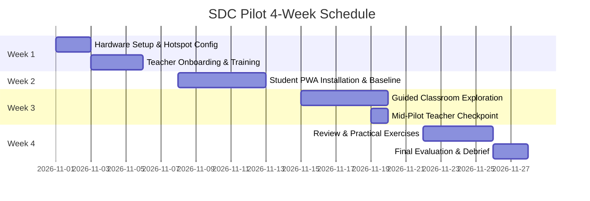

# SDC Pilot — Field Pilot Evaluation Protocol
**Target Setting:** Rural Sindh School Lab (Middle / High School, Sindh Medium)  
**Curriculum Scope:** Class 6 General Science (Sindh Textbook Board)  
**Hardware Appliance:** Raspberry Pi 5 (8 GB RAM, ARM64) with 12V Solar Power System  
**Clients:** 15–20 Android Tablets/Smartphones (1–2 GB RAM) via local Wi-Fi router  

---

## 1. Pilot Objectives & Key Success Metrics

The Sindhi Digital Classroom (SDC) Pilot evaluates an offline RAG educational assistance system designed to support students and teachers where cellular coverage and grid electricity are unreliable or absent.

### Key Performance Indicators (KPIs)

| Metric | Target | Verification Method |
|---|---|---|
| **RAG Answer Accuracy** | $\ge 80\%$ | Weekly blind teacher evaluation of student queries and AI answers |
| **Citation Dual-Number Accuracy** | $100\%$ | Automated test: every answer must cite `"PDF X (printed Y)"` |
| **Offline Appliance Uptime** | $100\%$ | Pi system uptime logs during school hours (8:00 AM – 1:30 PM) |
| **Response Latency (p95)** | $< 50\text{ ms}$ | Automated query latency tracking on the Pi 5 server |
| **Student Engagement Rate** | $\ge 70\%$ | Ratio of enrolled students submitting $\ge 3$ queries per week |
| **Chapter 7 Provenance Compliance**| $100\%$ | Mandatory blank-PDF warning banner on all Chapter 7 queries |

---

## 2. Four-Week Pilot Deployment Timeline

### Week 1: Infrastructure Deployment & Teacher Onboarding
- **Day 1–2:** Field technician mounts 12V solar panel, connects charge controller, initializes Raspberry Pi 5 appliance, and tests Wi-Fi router coverage.
- **Day 3–5:** 2-hour training session with school science teachers using the [Teacher Training Guide](file:///d:/Ai%20Agents/agency-agents/sindhi-digital-classroom/docs/TEACHER_TRAINING_GUIDE.md). Teachers practice searching in Sindhi, exploring the 201 glossary terms, and checking physical textbook citations.

### Week 2: Student Launch & Baseline Assessment
- Students connect their Android devices to `Sindhi_Digital_Classroom` and add the PWA to their home screen.
- Orientation on searching science topics: e.g., `جيو گهرڙو ڇا آهي؟` (What is a cell?), `خوردبيني جا حصا` (Microscope parts).
- Baseline search log audit to verify zero crashes on 1–2 GB RAM devices.

### Week 3: Curriculum Integration & Mid-Pilot Review
- Teachers use the **Exercises (39 items)** and **Glossary (201 terms)** screens during regular science periods.
- Mid-pilot review meeting: Teacher reviews 30 random anonymized query-answer pairs and grades them on educational accuracy (Scale 1–5).

### Week 4: Summative Assessment & Pilot Closeout
- Administer a 20-question science quiz comparing concepts studied with SDC assistance.
- Collect teacher feedback forms and export local anonymized audit logs.

---

## 3. Data Collection & Privacy Safeguards

### Non-Negotiable Privacy Mandate
- **Zero Real Student PII**: No student names, national ID (B-Form), phone numbers, or photos are ever collected or stored on the Pi.
- **Anonymized Local Query Logs**: SQLite records only:
  - Timestamp (UTC)
  - Normalized Query Text (Perso-Arabic script)
  - Retrieved Chunk IDs (e.g., `ch1-01`)
  - Execution Latency (milliseconds)
  - Teacher Flag (`is_flagged_wrong`)
- **No Cloud Synchronization**: All data stays entirely within the school's local SQLite database.

---

## 4. Teacher Evaluation & Rating Rubric

Teachers evaluate RAG responses using the following standardized 5-point scale:

1. **5 - Excellent (بهترين):** Answer is clear, 100% correct in Sindhi, citing the exact page of the Sindh Textbook Board book.
2. **4 - Good (ٺيڪ):** Answer is accurate but could be more complete; page citations are correct.
3. **3 - Acceptable (قبول جوڳو):** Answer is partially relevant; minor concept omissions.
4. **2 - Needs Work (اصلاح طلب):** Answer is too generic or misses the core question.
5. **1 - Incorrect / Out of Scope (غلط / غير نصابي):** Answer contains factual inaccuracies or cites incorrect pages.

Target: $\ge 85\%$ of reviewed answers must receive a rating of 4 or 5.

---

## 5. Contingency & Fallback / Rollback Plan

If any component of the digital system experiences downtime:
1. **Solar / Battery Depletion:**
   - The solar power monitor safely checkpoints SQLite (`wal_checkpoint(TRUNCATE)`) and powers off before brownout.
   - Teachers immediately revert to physical printed textbooks using the printed page numbers provided in the syllabus companion.
2. **Wi-Fi Router Failure:**
   - Field technician activates the internal Raspberry Pi 5 hotspot using `sudo bash deploy/setup_offline_hotspot.sh`.
   - Students reconnect directly to the Pi's internal Wi-Fi (`192.168.4.1:8000/classroom`).
3. **PWA Client Glitches:**
   - Students refresh Chrome or clear site data; the Service Worker will restore the app shell from cache.
4. **Complete Hardware Damage:**
   - Swap the MicroSD card into a backup Raspberry Pi (Pi 4 or Pi 5) — the entire system boots and operates identically.
