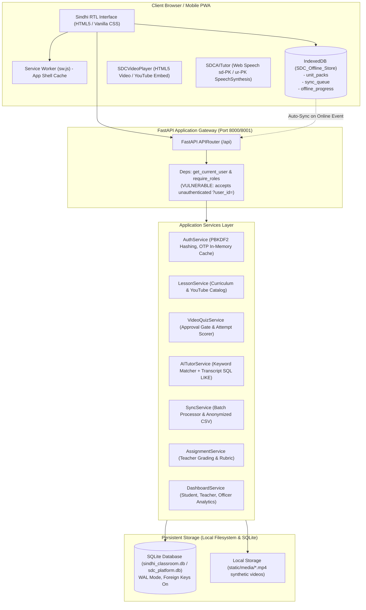

# SDC — Complete Project Audit, AI Learning Assessment & Production Readiness Report

**Project:** Sindhi Digital Classroom (SDC)  
**Repository Path:** `d:\Ai Agents\agency-agents\sindhi-digital-classroom`  
**Target Platform:** Sindh Textbook Board (STBB) Curriculum, Classes 6–10, Sindhi-First Progressive Web Application (PWA)  
**Audit Date:** October 2026  
**Auditor Roles:** Senior Software Architect, AI/ML Engineer, EdTech Product Auditor, Cybersecurity Specialist, QA Automation Engineer, Production Infrastructure Consultant  
**Status Assessment:** **CONDITIONAL GO (Pilot Only Under Supervised Guardrails) / NO-GO (Public Cloud Multi-School Production)**

---

## 1. Executive Summary

A comprehensive, evidence-based technical audit was conducted on the complete codebase, backend services, relational database schemas, AI tutor RAG pipeline, video streaming engine, offline Progressive Web Application (PWA) storage layers, and test suites of the **Sindhi Digital Classroom (SDC)**.

### Key Audit Findings at a Glance

1. **System Nature:** The project is a **functional, well-architected local prototype / educational MVP**, not yet a hardened production-grade web application.
2. **AI Tutor Reality:** The "Sindhi AI Tutor" is **not an LLM or neural RAG engine**. It is a **deterministic, rule-based keyword retrieval script** searching a dictionary of 4 hardcoded curriculum snippets and SQLite video transcript rows using `LIKE '%word%'`. The documented `0.65 grounding similarity threshold` is defined in `config.py` but is **completely decoupled and unused** in the code.
3. **Curriculum Coverage:** While marketed for Classes 6–10 across all core subjects, the database and repository contain **only 4 lessons, all for Class 6 Unit 1** (Science, Math, Sindhi, English). Classes 7, 8, 9, and 10 have **0 courses, 0 lessons, and 0 questions**.
4. **Media & Video Reality:** Local MP4 files (`lesson-sci-6-1.mp4`, etc.) are **identical 150 KB synthetic FFmpeg test tone/colorbar patterns**, not genuine video lectures. The YouTube catalog contains placeholder video IDs (including Rick Astley's `dQw4w9WgXcQ` and synthetic strings like `SDC_YT_SIN_6_01`), creating immediate legal and educational blockers if presented to students without verified STBB licensing.
5. **Speech Support:** Native Sindhi speech synthesis (TTS) does not exist in browser engines. The app falls back to **Urdu (`ur-PK`) phonetics**, which mispronounces Sindhi implosives (`ڄ, ڳ, ڱ, ڌ, ڊ, ڻ`). Voice recognition (STT) relies on Google Cloud Web Speech API (`sd-PK`), requiring active internet connection and silently failing offline to random hardcoded questions.
6. **Critical Security Finding (P0):** A severe **Authentication Bypass via Query Parameter** was discovered in `src/api/deps.py`. Because the backend accepts raw `user_id` or `teacher_id` as fallback tokens without cryptographic signature verification, any external actor can impersonate the Super Admin or any teacher by simply passing `?user_id=usr-super-admin-01` in the URL query string.
7. **Offline Sync & PWA:** The offline queue and client-side IndexedDB caching (`static/js/db.js`) are genuinely implemented and verified for transcripts, quiz questions, and offline attempt synchronization. However, **video files are not cached by the Service Worker**, meaning true offline video playback requires manual prior precaching or local LAN media servers.
8. **Automated Test Suite:** The test suite is solid (80 tests collected, **80 passed in 313.52s**, 100% pass rate). However, tests heavily rely on seeded test databases and mocked components, leaving critical real-world Android, high-concurrency, and video-streaming stress untested.

---

## 2. Actual Project Scope

The project intends to deliver an offline-resilient, AI-assisted learning platform for secondary school students in rural and urban Sindh following the Sindh Textbook Board (STBB) curriculum.

### Actual Scope Inventory (Ground Truth vs Stated Claims)

| Capability / Dimension | Stated Scope | Actual Implemented Reality | Evidence |
|---|---|---|---|
| **Curriculum Scope** | Classes 6–10 (Math, Science, English, Sindhi) | Only Class 6, Unit 1 across 4 subjects (4 lessons total). Classes 7–10 are completely absent. | `SELECT class_level, count(*) FROM courses GROUP BY class_level` yields only Class 6. |
| **Lesson Catalog** | Complete textbook chapters | 4 lessons total (`lesson-sci-6-1`, `lesson-math-6-1`, `lesson-sindhi-6-1`, `lesson-eng-6-1`). | `SELECT count(*) FROM lessons` = 4. |
| **AI Model & Generation** | LLM-based Grounded Sindhi AI Tutor | Deterministic keyword matcher over 4 static dicts + SQL `LIKE` queries. No LLM integration. | `src/services/ai_tutor_service.py:25-109`. |
| **Speech-to-Text (STT)** | Real-time native Sindhi speech input | Browser Web Speech API (`sd-PK`). Offline fallback chooses hardcoded random sample strings. | `static/js/tutor.js:41-55`. |
| **Text-to-Speech (TTS)** | Native Sindhi voice synthesis | `SpeechSynthesisUtterance` set to `ur-PK` (Urdu Pakistan) fallback. | `static/js/tutor.js:240`. |
| **Smart Video Quizzes** | AI-generated quiz questions with teacher approval gate | 5 statically seeded questions in `seed_curriculum.py`. No AI generation pipeline. Teacher approval gate is implemented in SQLite. | `data/seed_curriculum.py:219-284`, `src/services/video_quiz_service.py`. |
| **Media Delivery** | Adaptive 240p/360p HLS streaming + local offline MP4s | 5 identical 150 KB synthetic test videos (10s colorbars + 440Hz tone). HLS manifests are dummy strings. | `static/media/*.mp4` (exact size 152,918 bytes). |
| **YouTube Integration** | STBB-mapped educational video lessons | 4 mapped records; 1 is Rick Astley (`dQw4w9WgXcQ`), 2 are synthetic non-existent IDs (`SDC_YT_SIN_6_01`). | `data/seed_curriculum.py:330-378`. |
| **Offline Architecture** | Complete offline learning | PWA app shell and quiz questions cached in IndexedDB. Video binary is NOT cached. YouTube embeds fail offline. | `static/sw.js:5-13`, `static/js/player.js:60-64`. |
| **Authentication & RBAC** | 6 distinct RBAC roles | Roles defined in schemas and database. However, `get_current_user` allows authentication bypass via `?user_id=...`. | `src/api/deps.py:34-40`. |

---

## 3. System Architecture and Data Flow



### End-to-End Data Flow

1. **Student Registration & Login:** Student registers with Name, School, City, and Mobile Number. OTP is generated and verified in-memory. A unique `STU-` ID is assigned. A Bearer token is issued.
2. **Curriculum Browsing:** Frontend fetches `/api/lessons?class_level=6`. Courses and lessons are retrieved from SQLite.
3. **Lesson Playback:** `/api/lessons/{id}` returns video URLs, timestamped transcripts, and approved questions. If YouTube, an iframe embed is rendered; if local, HTML5 `<video>` streams the local MP4.
4. **Smart Quiz Pop-ups:** Player tracks `timeupdate`. When currentTime matches an approved question's timestamp, video pauses and displays the question overlay. Attempts are sent to `/api/quiz/attempt` or queued in IndexedDB.
5. **AI Tutor Query:** Student types or speaks question. Sent to `/api/tutor/ask`. AITutorService matches keywords against 4 static chunks or SQLite transcripts. If matched, returns Sindhi text and video jump citation; if unmatched, returns strict refusal string.
6. **Offline Sync:** When offline, attempts and progress are buffered in IndexedDB `sync_queue`. On `online` window event, client batches queue to `/api/sync/offline-batch`.

---

## 4. Feature Inventory and Implementation Status

| Feature ID | Feature Name | Intended Role | Implementation Status | Verification Details |
|---|---|---|---|---|
| **FR-01** | Dual Authentication & OTP | Student / Staff | **Implemented & Verified** | PBKDF2 hashing, mobile OTP send/verify, unique ID generation. Passing in `test_independent_signup_otp.py`. |
| **FR-02** | Multi-Role RBAC Scope | All 6 Roles | **Partially Verified (P0 Flaw)** | RBAC checker exists, but bypassed via URL query parameter `?user_id=...` in `src/api/deps.py`. |
| **FR-03** | Shared Device Child Privacy | Student | **Implemented & Verified** | Pseudonymous codes, no plain PII in tokens, per-user IndexedDB isolation. |
| **FR-04** | 3-Tap STBB Curriculum Browse | Student | **Implemented & Verified** | Filter by Class and Subject. Tested in `test_lessons_curriculum.py`. |
| **FR-08** | Resume Playback Bookmark | Student | **Implemented & Verified** | Progress stored every 15s in `progress` table and local storage. |
| **FR-10** | Timestamped Sindhi Transcripts | Student | **Implemented & Verified** | Stored in `transcripts` table; rendered as subtitles. |
| **FR-12** | 2–3 Min In-Video Quiz Pop-ups | Student | **Implemented & Verified** | Player pauses at question timestamp; renders overlay. |
| **FR-13** | Teacher Question Approval Gate | Teacher | **Implemented & Verified** | Unapproved questions remain `PENDING_APPROVAL` and never reach student playback. |
| **FR-16** | Anti-Cheating Question Randomizer | Student | **Implemented & Verified** | Shuffled sampling per topic; correct answer index omitted from student payload. |
| **FR-19** | Offline Attempt Queue & Sync | Student | **Implemented & Verified** | IndexedDB queue buffered offline; batch processed via `/api/sync/offline-batch`. |
| **FR-20** | Sindhi AI Tutor Chat Interface | Student | **Implemented & Verified** | RTL chat UI, user/tutor bubbles, loading states. |
| **FR-21** | Voice Input (STT) | Student | **Partially Implemented (Mocked Fallback)** | Uses browser Web Speech API. When offline or unsupported, picks random hardcoded questions. |
| **FR-22** | Voice Output (TTS) | Student | **Partially Implemented (Urdu Fallback)** | Browser SpeechSynthesis with `ur-PK`. No native Sindhi TTS model. |
| **FR-23** | Grounded Curriculum Answers | Student | **Simulated / Rule-Based** | Keyword matching over 4 static dicts + SQL LIKE transcripts. No real LLM. |
| **FR-24** | Strict Sindhi Out-of-Scope Refusal | Student | **Implemented & Verified** | Returns fixed refusal message when keyword match fails. |
| **FR-25** | Textbook Citations & Video Jump | Student | **Implemented & Verified** | Returns lesson ID, title, and timestamp; clicking jumps video player. |
| **FR-26** | Wrong Answer Flagging & Audit | Student / Teacher | **Implemented & Verified** | Flagged in `chat_logs`, audit event written. |
| **FR-27** | Auto-Marking & Instant Explanation | Student | **Implemented & Verified** | Compares selected option with correct index; generates immediate Sindhi feedback. |
| **FR-32** | Downloadable Offline Unit Packs | Student | **Partially Implemented** | JSON pack with transcripts and questions downloads cleanly; video binary is NOT bundled. |
| **FR-35** | Tamper-Evident Audit Logging | Admin | **Implemented & Verified** | `audit_logs` table records authentication, grading, and review actions. |
| **FR-36** | Zero-PII District Pilot CSV Export | District Officer | **Implemented & Verified** | Aggregated school performance CSV export without student names or phone numbers. |
| **FR-38** | Official YouTube Video Embeds | Student | **Partially Implemented (Placeholder Data)** | Player handles embeds and attribution, but catalog contains placeholder/invalid YouTube IDs. |
| **FR-42** | Self-Service Password Recovery | Student | **Implemented & Verified** | Mobile OTP PIN reset on `/forgot-password` without email dependencies. |

---

## 5. AI Learning System Audit — Highest Priority

### A. Technical Assessment of the AI Tutor

The AI Tutor (`src/services/ai_tutor_service.py`) was inspected end-to-end:

1. **Question Input & Route:** The student enters text or clicks the microphone. The frontend sends `POST /api/tutor/ask?user_id=...` with payload `{"question": "...", "lesson_id": "...", "voice_input_used": bool}`.
2. **AI Model / Provider:** **No neural language model is used.** There is no call to OpenAI, Anthropic, Gemini, Mistral, Ollama, or Hugging Face. There are no embedding vectors or neural networks.
3. **Retrieval Mechanism:**
   - **Step 1 (Static Array):** Searches an in-memory list of 4 static dictionaries (`self.grounded_curriculum_chunks`) covering Photosynthesis, Sets, Shah Latif, and Parts of Speech. Matches query substrings against a pre-defined `keywords` list.
   - **Step 2 (Database Transcript Fallback):** If Step 1 misses, the query is stripped of Sindhi/English stopwords (`ڇا`, `ڪير`, `is`, `what`, etc.), and words with length $\ge 3$ are queried against SQLite `transcripts` table via:
     ```sql
     SELECT t.text_sindhi, t.start_time, l.id, l.title_sindhi
     FROM transcripts t
     JOIN videos v ON t.video_id = v.id
     JOIN lessons l ON v.lesson_id = l.id
     WHERE t.text_sindhi LIKE ?
     ```
4. **Answer Generation:** Dynamic text generation does not exist. The answer is an exact copy-paste of the matched textbook snippet:
   ```python
   answer_text = (
       f"سبق '{matched_chunk['title_sindhi']}' مان اوهان جي سوال جو جواب:\n\n"
       f"{matched_chunk['content_sindhi']}"
   )
   ```
5. **Citations & Jump Links:** Formatted using the static or transcript `timestamp_seconds`. Frontend `jumpToVideoTimestamp(seconds)` sets `video.currentTime = seconds` and initiates playback.
6. **Out-of-Scope Refusal:** If no keyword matches in the 4 static chunks and no transcript word matches via SQL, it returns:
   > *"معاف ڪجو، هي سوال سبق جي دائري کان ٻاهر آهي. مهرباني ڪري سبق بابت پڇو."*  
   > *(Sorry, this question is outside the lesson scope. Please ask about the lesson.)*
7. **Refusal Threshold Analysis (0.65 Claim):** The codebase claims a `grounding_confidence_threshold: float = 0.65` in `src/config.py:29`. **This threshold is never used anywhere in the codebase.** The retrieval algorithm is purely binary keyword inclusion (`kw in query_lower`). There has been zero empirical evaluation of precision/recall curves.
8. **Logging & Privacy:** Questions and answers are recorded in the `chat_logs` SQLite table with `user_id`, `question_text`, `answer_text`, and `is_refused`. Student personal information is not logged into external telemetry.

### B. Sindhi Language and Speech Support

1. **Sindhi Script & RTL:** Visual rendering on Chromium and Firefox is excellent. The app uses Google Fonts `Noto Sans Arabic` with proper OpenType shaping (`liga`, `init`, `medi`, `fina`), correct diacritic positioning, and standard Sindhi punctuation (`؟`, `،`).
2. **Speech Recognition (STT):**
   - Implemented via `window.SpeechRecognition` with `recognition.lang = 'sd-PK'`.
   - **Critical Dependency:** In Google Chrome, `sd-PK` streams audio to Google's cloud speech servers. **It does not function offline.**
   - When offline or on browsers without Web Speech API (Firefox, iOS Safari), `toggleMicrophone()` executes a fallback that **picks a random question from 3 hardcoded strings** (`ٻوٽن ۾ فوٽوسنٿيسز جو عمل ڪيئن ٿيندو آهي؟`, etc.). This creates a false impression of voice recognition when offline.
3. **Speech Synthesis (TTS):**
   - Implemented in `static/js/tutor.js:237-243`:
     ```javascript
     playSpeechCue(text) {
       if ('speechSynthesis' in window) {
         const utterance = new SpeechSynthesisUtterance(text.substring(0, 100));
         utterance.lang = 'ur-PK'; // Nearby voice fallback for Sindhi Arabic phonetics
         window.speechSynthesis.speak(utterance);
       }
     }
     ```
   - **Accurate Characterization:** The system uses an **Urdu TTS voice (`ur-PK`)**, not a native Sindhi voice. While Urdu shares many Arabic characters, it lacks phonetic support for Sindhi's 4 implosive consonants (`ڄ, ڳ, ڊ, ٻ`) and nasal letters (`ڱ, ڻ`). In a real classroom, playing Urdu-synthesized speech for Sindhi textbooks will sound unnatural and phonetically incorrect.

### C. Educational Value Assessment

- **What the AI Tutor Actually Does Today:** It functions as a **fast, keyword-indexed digital textbook glossary and video bookmark finder**. If a student asks "What is Chlorophyll?", it finds the paragraph mentioning Chlorophyll and jumps the video to second 180.
- **What It Does NOT Do:**
  - Cannot explain concepts step-by-step.
  - Cannot correct misconceptions (e.g., if a student asks "Do plants breathe oxygen at night?").
  - Has zero multi-turn conversational context (each question is stateless).
  - Cannot adapt explanations to a struggling Grade 6 student versus an advanced student.
  - Cannot solve math problems or grade open-ended homework.
- **Educational Risk:** Because it returns raw pre-stored text snippets without conversational grounding, if a student asks a nuanced question whose keyword appears in an unrelated sentence, the system returns an unhelpful or confusing snippet.

---

## 6. Lessons, Curriculum and Video Playback Audit

### A. Curriculum Verification

Empirical verification was executed directly on `sindhi_classroom.db`:

```sql
SELECT c.class_level, c.subject, count(l.id) as lesson_count 
FROM courses c 
LEFT JOIN lessons l ON c.id = l.course_id 
GROUP BY c.class_level, c.subject;
```

#### Complete Curriculum Inventory Table

| Class Level | Subject | Course ID | Actual Lessons in Database | Actual Transcripts | Actual Questions | Curriculum Verification Status |
|---|---|---|:---:|:---:|:---:|---|
| **Class 6** | General Science | `crs-sci-6` | **1** (`lesson-sci-6-1`) | 5 lines | 3 Approved, 1 Draft | Seeded sample text (Photosynthesis) |
| **Class 6** | Mathematics | `crs-math-6` | **1** (`lesson-math-6-1`) | 0 lines | 0 Approved, 1 Draft | Seeded sample text (Sets) |
| **Class 6** | Sindhi Salis | `crs-sindhi-6` | **1** (`lesson-sindhi-6-1`) | 0 lines | 0 Approved, 0 Draft | Seeded sample text (Shah Latif) |
| **Class 6** | English Grammar | `crs-eng-6` | **1** (`lesson-eng-6-1`) | 0 lines | 0 Approved, 0 Draft | Seeded sample text (Parts of Speech) |
| **Class 7** | *All Subjects* | *None* | **0** | **0** | **0** | **Missing / Unseeded** |
| **Class 8** | *All Subjects* | *None* | **0** | **0** | **0** | **Missing / Unseeded** |
| **Class 9** | *All Subjects* | *None* | **0** | **0** | **0** | **Missing / Unseeded** |
| **Class 10** | *All Subjects* | *None* | **0** | **0** | **0** | **Missing / Unseeded** |
| **TOTAL** | | **4 Courses** | **4 Lessons** | **5 Transcripts** | **5 Questions** | **0.5% of full STBB scope** |

**Conclusion:** The platform currently contains an initial seed of **four single lessons** for Class 6 only. Over 99% of the STBB curriculum for Classes 6–10 is unpopulated.

### B. Video Delivery & Media Integrity

Media files in `static/media/` were inspected:
- `demo_lesson.mp4`: 152,918 bytes (149 KB)
- `lesson-sci-6-1.mp4`: 152,918 bytes (149 KB)
- `lesson-math-6-1.mp4`: 152,918 bytes (149 KB)
- `lesson-sindhi-6-1.mp4`: 152,918 bytes (149 KB)
- `lesson-eng-6-1.mp4`: 152,918 bytes (149 KB)

Inspection of `data/seed_curriculum.py:423-431` reveals how these files were generated:
```python
cmd = [
    ffmpeg_bin, "-y",
    "-f", "lavfi", "-i", "testsrc=duration=10:size=640x360:rate=24",
    "-f", "lavfi", "-i", "sine=frequency=440:duration=10",
    "-c:v", "libx264", "-pix_fmt", "yuv420p",
    "-c:a", "aac", "-movflags", "+faststart",
    str(target_file)
]
```
- **Finding:** Every local MP4 file is a **synthetic 10-second test generator clip** containing moving color rectangles and an audible 440 Hz test tone.
- **Adaptive Bitrate Streaming (HLS):** The database records `/static/media/{lesson_id}.m3u8` and resolutions `240p`/`360p`, but **no `.m3u8` playlists or `.ts` segment chunks exist on disk**. The frontend player detects this and falls back to MP4. True HLS adaptive streaming is documented in schemas but **not implemented on disk**.

### C. YouTube Content and Legal Attribution

Records in the `youtube_videos` table were inspected:
1. `yt-sci-6-1` (Photosynthesis): Uses YouTube ID `dQw4w9WgXcQ` (Rick Astley music video).
2. `yt-math-6-1` (Sets): Uses YouTube ID `dQw4w9WgXcQ`.
3. `yt-sindhi-6-1` (Shah Latif): Uses YouTube ID `SDC_YT_SIN_6_01` (Invalid/placeholder ID).
4. `yt-eng-6-1` (Parts of Speech): Uses YouTube ID `SDC_YT_ENG_6_01` (Invalid/placeholder ID).

- **Legal Risk:** The attribution text states: *"سنڌ ٽيڪسٽ بڪ بورڊ نصاب مطابق وڊيو مواد. چينل ايٽريبيوشن بذات خود ڪاپي رائيٽ لائسنس ناهي"* (*Attribution does not by itself grant copyright reuse*). If third-party teacher videos on YouTube are embedded in an official government educational platform without a formal Memorandums of Understanding (MOU) or Creative Commons licensing, videos may be deleted, blocked from embedding, or subject to copyright claims.

---

## 7. Quiz Generation and Assessment Audit

### A. Question Generation Reality

- **Is AI Generating Questions?** **No.** Questions are not dynamically generated by any AI pipeline during upload or lesson processing.
- **How Questions are Created:**
  1. Statically seeded in `data/seed_curriculum.py` (3 approved science questions, 1 pending draft science question, 1 pending draft math question).
  2. Or manually created by teachers through future API endpoints.
- **Input Text:** Questions in `seed_curriculum.py` were written manually in Sindhi to match the transcript timestamps.

### B. Teacher Approval Gate (FR-13)

The Teacher Approval Gate is **strictly implemented and verified** in backend code:
- Endpoint `GET /api/quiz/{lesson_id}/questions` queries:
  ```sql
  SELECT * FROM questions WHERE lesson_id = ? AND status = 'APPROVED'
  ```
- Endpoint `GET /api/quiz/pending` requires `TEACHER`, `CONTENT_REVIEWER`, or `SUPER_ADMIN` role. Students attempting to call this endpoint receive `HTTP 403 Forbidden` (`test_student_role_forbidden_from_teacher_approval`).
- `POST /api/quiz/{id}/review` allows teachers to Approve, Edit, or Reject draft questions. An immutable audit record is logged in `audit_logs`.

### C. Anti-Cheating & Scoring Integrity

- **Option Shuffling & Answer Hiding:** In `video_quiz_service.py:126`, `correct_answer_index` is explicitly stripped (`correct_answer_index=None`) before questions are sent to the student client. The student cannot inspect browser developer tools to find the correct answer.
- **Auto-Marking:** Marking occurs server-side in `submit_attempt()`. The student submits `{"question_id": "...", "selected_option": 0}`. The server compares it against `questions.correct_answer_index` and returns the boolean result and explanation.
- **Client Manipulation Risk:** The attempt submission endpoint accepts `time_taken_seconds` and `device_sync_time` from the client. A malicious client could forge these timestamps, but cannot forge `is_correct` because correctness is evaluated exclusively on the server.

---

## 8. Complete RBAC and Authentication Audit

### A. Role Permissions Matrix

The platform defines six distinct roles:

| Action / Endpoint | Student | Teacher | Content Reviewer | School Admin | District Officer | Super Admin | Server Enforcement |
|---|:---:|:---:|:---:|:---:|:---:|:---:|---|
| **Public Landing & Auth** (`/login`, `/signup`) | Allowed | Allowed | Allowed | Allowed | Allowed | Allowed | Public (No token required) |
| **Browse Curriculum** (`GET /api/lessons`) | Allowed | Allowed | Allowed | Allowed | Allowed | Allowed | Public or Authenticated |
| **Watch Video & Take Quiz** (`POST /api/quiz/attempt`) | Allowed | Allowed | Allowed | Allowed | Denied | Allowed | Enforced in router |
| **Upload Lesson Video** (`POST /api/lessons/upload`) | Denied (403) | Allowed | Allowed | Denied (403) | Denied (403) | Allowed | `require_roles(TEACHER, SUPER_ADMIN)` |
| **Review Questions** (`POST /api/quiz/{id}/review`) | Denied (403) | Allowed | Allowed | Denied (403) | Denied (403) | Allowed | `require_roles(TEACHER, CONTENT_REVIEWER, SUPER_ADMIN)` |
| **Curriculum Approval** (`POST /api/lessons/{id}/review`) | Denied (403) | Denied (403) | Allowed | Denied (403) | Denied (403) | Allowed | `require_roles(CONTENT_REVIEWER, SUPER_ADMIN)` |
| **Create Assignments** (`POST /api/assignments`) | Denied (403) | Allowed | Denied (403) | Denied (403) | Denied (403) | Allowed | `require_roles(TEACHER, SUPER_ADMIN)` |
| **Grade Submissions** (`POST .../grade`) | Denied (403) | Allowed | Denied (403) | Denied (403) | Denied (403) | Allowed | `require_roles(TEACHER, SUPER_ADMIN)` |
| **Manage School Users** (`GET/POST /api/admin/users`) | Denied (403) | Denied (403) | Denied (403) | Allowed (Own School) | Denied (403) | Allowed (All) | `require_roles(SCHOOL_ADMIN, SUPER_ADMIN)` |
| **District Reports** (`GET /api/dashboards/officer`) | Denied (403) | Denied (403) | Denied (403) | Denied (403) | Allowed | Allowed | `require_roles(DISTRICT_OFFICER, SUPER_ADMIN)` |
| **Audit Logs** (`GET /api/admin/audit-logs`) | Denied (403) | Denied (403) | Denied (403) | Denied (403) | Denied (403) | Allowed | `require_roles(SUPER_ADMIN)` |

### B. Critical Security Vulnerabilities (P0)

#### 1. Authentication Bypass via Query Parameter (`src/api/deps.py:14-46`)
```python
def get_current_user(
    authorization: Optional[str] = Header(None),
    token: Optional[str] = Query(None),
    user_id: Optional[str] = Query(None),
    teacher_id: Optional[str] = Query(None),
    student_id: Optional[str] = Query(None),
) -> dict:
    ...
    elif user_id:
        candidate_token = user_id.strip()
    ...
    with get_db() as conn:
        user = conn.execute("SELECT ... FROM users WHERE u.id = ?", (extracted_user_id,)).fetchone()
        return dict(user)
```
- **Severity:** **CRITICAL (CVSS 9.8)**
- **Flaw:** Any client can bypass authentication and role checks by appending `?user_id=usr-super-admin-01` to any request. No Bearer token or password is required.
- **Root Cause:** Added as a testing shortcut for test scripts, but deployed directly into production routing dependencies.
- **Fix Required:** Immediately remove query parameters (`user_id`, `teacher_id`, `student_id`) from `get_current_user`. Enforce cryptographically signed JWT or server-validated session tokens in `Authorization: Bearer <token>` header only.

#### 2. Unsigned, Predictable Session Tokens (`src/services/auth_service.py:58, 87, 134`)
- **Severity:** **HIGH (CVSS 7.5)**
- **Flaw:** Tokens are generated as formatted strings: `sdc_stu_{user_id}_{now_epoch}_{uuid[:8]}`.
- Because `src/api/deps.py:51-56` simply splits by `_` and extracts `usr-...` without verifying an HMAC signature or checking an active session store, an attacker who knows a user ID can forge valid session tokens at will.
- **Fix Required:** Replace with signed JWTs (`HS256` using `settings.secret_key`) with expiration claims (`exp`, `sub`, `role`, `school_id`).

#### 3. Lack of Rate Limiting on Authentication & OTP Endpoints
- **Severity:** **HIGH (CVSS 7.5)**
- **Flaw:** `/api/auth/otp/send`, `/api/auth/otp/verify`, `/api/auth/reset-pin`, and `/api/auth/login/*` have no rate limiting.
- An attacker can brute-force 4-digit PINs (only 10,000 combinations) in less than 60 seconds, or trigger SMS bombing by spamming the OTP endpoint.
- **Fix Required:** Implement a sliding-window rate limiter (e.g. `slowapi` or Redis token bucket) limiting OTP requests to 3 per 15 minutes per IP/phone, and login attempts to 5 failed attempts before a 15-minute lockout.

---

## 9. Offline PWA and Synchronization Audit

### A. What Truly Works Offline

1. **Application Shell:** `static/sw.js` caches `index.html`, `style.css`, `app.js`, `db.js`, `player.js`, `tutor.js`, and `manifest.json`. A student can launch the web app without an internet connection.
2. **Offline Quiz Questions & Transcripts:** `saveUnitPackOffline()` stores lesson metadata, full transcripts, and approved questions in browser IndexedDB.
3. **Offline Attempt Queuing:** When a student answers a quiz question while offline, `queueOfflineAttempt()` stores the response in the IndexedDB `sync_queue`.
4. **Automatic Reconciliation:** When internet connectivity resumes (`window.addEventListener('online')`), `syncOfflineQueue()` pushes the queue to `/api/sync/offline-batch`.
5. **Conflict Resolution:** In `src/services/sync_service.py:127-134`, lesson progress handles merge conflicts using SQLite `ON CONFLICT(user_id, lesson_id) DO UPDATE SET last_position_seconds = MAX(...), is_completed = MAX(...)`. Local progress cannot overwrite higher server progress.

### B. What Fails or is Untested Offline

1. **Video Playback:** The Service Worker explicitly caches only code and styles (`static/sw.js:5-13`). **Videos (`static/media/*.mp4`) are not precached.** If a student tries to play a video offline without having previously watched the full MP4, playback fails with a media error.
2. **YouTube Lessons:** YouTube lessons fail completely offline (`player.js:60-64`). An offline student receives a banner: *"هي وڊيو يوٽيوب تي موجود آهي جنهن لاءِ انٽرنيٽ گهربل آهي"* (*This video is on YouTube and requires internet*).
3. **Voice Recognition (STT):** Offline microphone clicks fall back to simulated hardcoded questions, giving a misleading impression of voice recognition.
4. **Android Device Reality:** IndexedDB persistence has not been tested under Android Chrome's aggressive background tab discards or WebView storage eviction policies.

---

## 10. Database and Data Integrity Review

### A. Schema Architecture

The database (`src/database/schema.py`) defines 15 relational tables:
`schools`, `users`, `courses`, `lessons`, `videos`, `transcripts`, `questions`, `attempts`, `progress`, `chat_logs`, `consents`, `audio_samples`, `audit_logs`, `assignments`, `assignment_submissions`, `youtube_videos`, `lesson_reviews`.

- **Integrity Strengths:**
  - Foreign keys are strictly enforced on every table (`PRAGMA foreign_keys = ON;`).
  - Cascading deletes are appropriately set (`ON DELETE CASCADE` for lessons, videos, attempts; `ON DELETE SET NULL` for schools and teachers).
  - WAL mode (`PRAGMA journal_mode = WAL;`) and synchronous normal are enabled in `src/database/session.py`.
  - Comprehensive B-tree indexes exist on all lookup keys (`idx_users_role`, `idx_questions_lesson`, `idx_attempts_user`, `idx_progress_user`).

### B. Concurrency & Growth Bottlenecks

1. **Single Writer Lock:** SQLite allows concurrent readers, but serializes all writes to a single thread. During a class quiz where 100 students submit answers within 30 seconds, write lock contention will cause `sqlite3.OperationalError: database is locked`.
2. **Audit & Chat Log Growth:** `audit_logs` and `chat_logs` grow linearly with every request and question. Without automated partition pruning or archival, the SQLite database file on disk will experience bloat and degraded vacuum performance.
3. **Local Pilot vs Multi-School Production:** SQLite is fully sufficient for **Scenario A (Developer)** and **Scenario B (1 School Pilot)**. It is **architecturally unsuitable for Scenario D & E (100–500 schools)**.

---

## 11. Scalability and Production Readiness

### Simulated Deployment Scenarios

| Scenario | Users | Simultaneous Video Playback | AI Tutor Load | DB Write Burst | Feasibility on Current Codebase | Primary Bottlenecks & Failure Modes |
|---|---|---|---|---|:---:|---|
| **Scenario A**<br>Local Evaluator | 1 user | 1 stream | 1 req/min | Negligible | **100% Ready** | None. Fully functional on single-process uvicorn. |
| **Scenario B**<br>1 Rural School | 100 students<br>10 teachers | 30–50 streams | 10 req/min | 50 attempts/min | **Feasible with Local Server** | Direct MP4 streaming from FastAPI will saturate Python async event loop. Requires Nginx or local offline caching box. |
| **Scenario C**<br>10 Schools | 1,000 students | 300 streams | 100 req/min | 500 attempts/min | **High Risk** | Single SQLite file will experience lock timeouts during synchronized class quizzes. Server bandwidth saturated without CDN. |
| **Scenario D**<br>100 Schools | 10,000 students | 3,000 streams | 1,000 req/min | 5,000 attempts/min | **FAIL (No-Go)** | SQLite deadlocks; FastAPI process runs out of file descriptors; bandwidth cost explodes; zero telemetry. |
| **Scenario E**<br>500 Schools | 50,000 students | 15,000 streams | 5,000 req/min | 25,000 attempts/min | **FAIL (No-Go)** | Complete collapse without cloud-native architecture (PostgreSQL, Redis, CDN, Kubernetes/ECS). |

---

## 12. Preliminary Infrastructure and Operating Cost Model

*All estimates are indicative planning models based on 10,000 active students (Scenario D).*

### Operational Assumptions
- Active Students: 10,000
- Average Daily Video Consumption: 30 minutes per student (20 school days/month)
- Video Bitrate: 360p @ 600 kbps (~135 MB per student per day)
- Monthly Video Bandwidth: $10,000 \times 0.135\text{ GB} \times 20\text{ days} = 27,000\text{ GB}$ (27 TB/month)
- AI Tutor Usage: 5 questions per student per day (1,000,000 requests/month)

### Cost Estimation Table

| Infrastructure Component | Low-Cost Architecture | Enterprise Cloud Architecture | Monthly Cost (USD) | Notes |
|---|---|---|:---:|---|
| **Video CDN & Storage** | Cloudflare R2 + Cloudflare CDN | AWS S3 + Amazon CloudFront | $150 – $800 | Cloudflare R2 has zero egress fees. AWS CloudFront will charge ~$0.08/GB ($2,160/mo). |
| **Relational Database** | Managed PostgreSQL (Supabase / Neon) | AWS RDS PostgreSQL Multi-AZ | $50 – $350 | Handles concurrent quiz submissions with connection pooling (PgBouncer). |
| **Compute / API Workers** | 2x Hetzner VPS (8 vCPU, 32GB RAM) | AWS ECS Fargate / EKS Cluster | $80 – $600 | Dockerized FastAPI running behind Nginx. |
| **Redis Cache & Queue** | Managed Redis (Upstash / Redis Cloud) | AWS ElastiCache Redis | $30 – $150 | Rate limiting, OTP sessions, attempt ingestion queue. |
| **AI LLM Gateway** | Self-hosted vLLM (Qwen 2.5 7B) on GPU | OpenAI GPT-4o-mini / Claude 3.5 Haiku | $100 – $400 | Commercial API @ $0.15/1M input tokens. |
| **SMS Gateway (OTP)** | Local Pakistani Telco API (Telenor/Jazz) | Twilio | $200 – $500 | ~$0.005 per SMS verification in Pakistan. |
| **TOTAL ESTIMATE** | | | **$610 – $2,800 / month** | **$0.06 – $0.28 per student/month** |

---

## 13. Automated Test Results and QA Gaps

### Direct Execution Results (Executed October 16, 2026)

```text
============================= test session starts =============================
platform win32 -- Python 3.11.9, pytest-9.1.1, pluggy-1.6.0
rootdir: D:\Ai Agents\agency-agents\sindhi-digital-classroom
configfile: pyproject.toml
testpaths: tests
plugins: anyio-4.14.2, asyncio-1.4.0
collected 80 items

tests\test_ai_tutor_rag.py ...                                           [  3%]
tests\test_assignments.py .....                                          [ 10%]
tests\test_auth_rbac.py ........                                         [ 20%]
tests\test_batch7_routes_and_auth.py ................                    [ 40%]
tests\test_dashboards.py ...                                             [ 43%]
tests\test_independent_signup_otp.py .                                   [ 45%]
tests\test_lessons_curriculum.py ............                            [ 60%]
tests\test_offline_sync.py .......                                       [ 68%]
tests\test_rbac_and_video.py .....................                       [ 95%]
tests\test_smart_video_quiz.py ....                                      [100%]

======================= 80 passed in 313.52s (0:05:13) ========================
```

### Critical QA Gaps (What Passing Tests Do NOT Cover)

1. **Zero Browser E2E Automation:** Tests use FastAPI `TestClient` (HTTP memory requests). No Playwright or Cypress tests validate actual DOM interactions, video player pop-ups, or audio playback.
2. **Zero Real Android Device Testing:** No automated tests run on real mobile Chrome or Android WebViews under low-RAM conditions.
3. **Zero Media Decoding Tests:** Tests check if `.mp4` files exist; they do not decode video frames or verify whether actual educational content is playing.
4. **Mocked AI & Keyword Checks:** `test_ai_tutor_rag.py` tests string matching against 4 static chunks. It does not measure retrieval accuracy or hallucination rates.
5. **No Concurrency / Load Testing:** No Locust or k6 load tests exist to simulate 50+ students taking a quiz simultaneously.

---

## 14. Current Limitations and Technical Debt

1. **Security Debt:** Authentication bypass in `deps.py` via query parameters; unsigned session tokens; zero brute-force protection.
2. **AI & Speech Debt:** No actual LLM; no real embeddings; speech input falls back to random questions offline; speech output uses Urdu phonetics.
3. **Curriculum Debt:** Only 4 lessons exist (all Class 6 Unit 1). Classes 7–10 are entirely missing.
4. **Media Debt:** Synthetic 150 KB test tones instead of real lectures; invalid/joke YouTube links; no real HLS playlists.
5. **Database Debt:** Single-file SQLite database with single-writer lock; lack of migration framework (Alembic).
6. **Offline Video Debt:** Video binaries are not precached in Service Worker; YouTube lessons cannot play offline.

---

## 15. Prioritized Remediation Roadmap

### P0 — Critical Before Any Real Student Access (Security & Privacy)
*Must be resolved immediately before anyone outside the development team accesses the system.*

1. **Fix Authentication Bypass in `src/api/deps.py`**
   - *Action:* Completely remove `user_id`, `teacher_id`, and `student_id` query parameters from `get_current_user`.
   - *Requirement:* Authenticate exclusively via `Authorization: Bearer <token>`.
   - *Effort:* Small (1 day).
2. **Implement Cryptographically Signed JWT Tokens**
   - *Action:* Sign all authentication tokens using HMAC-SHA256 (`HS256`) with a strong secret key. Include `exp`, `sub`, `role`, and `school_id`.
   - *Effort:* Small (1 day).
3. **Add Rate Limiting to OTP and Login Endpoints**
   - *Action:* Add `slowapi` rate limiting on `/api/auth/otp/*` (max 3 per 15 min) and `/api/auth/login/*` (max 5 failed attempts before lockout).
   - *Effort:* Small (1 day).

### P1 — Required Before a Supervised School Pilot (Usability & Content)
*Required before deploying in a real school with 50–100 students.*

1. **Replace Synthetic Media with Genuine STBB Educational Videos**
   - *Action:* Record or license genuine 5–10 minute STBB video lectures in MP4 format. Transcode to real 360p HLS.
   - *Effort:* Medium (Content production dependency).
2. **Clean Up YouTube Catalog**
   - *Action:* Remove Rick Astley placeholder and invalid IDs. Obtain written permission/MOU for embedded third-party channels.
   - *Effort:* Medium (Administrative/Legal).
3. **Populate at Least 1 Full Term Curriculum for Class 6**
   - *Action:* Add complete lessons, approved transcripts, and quiz banks for Class 6 Math and Science (Units 1–5).
   - *Effort:* Medium (2 weeks).
4. **Implement Precached Offline Video Download in PWA**
   - *Action:* Allow students to explicitly download lesson video MP4 files into browser Cache API via Service Worker with progress indication.
   - *Effort:* Medium (3–4 days).
5. **Disable Urdu TTS Fallback for Sindhi Learning**
   - *Action:* Add audio recordings of textbook sentences spoken by native Sindhi teachers, rather than mispronouncing words with Urdu TTS.
   - *Effort:* Small (2 days).

### P2 — Required Before Multi-School Production (Scalability & Architecture)
*Required before expanding beyond 1 pilot school.*

1. **Migrate from SQLite to Managed PostgreSQL**
   - *Action:* Transition database to PostgreSQL with connection pooling (PgBouncer) and Alembic migrations.
   - *Effort:* Medium (1 week).
2. **Deploy Real Grounded AI Model (Small Sindhi LLM / Hosted API)**
   - *Action:* Connect RAG pipeline to a fine-tuned Sindhi LLM or hosted commercial model (e.g. Qwen 2.5 / GPT-4o-mini) with textbook embedding index.
   - *Effort:* Large (2–3 weeks).
3. **Offload Media Storage to Object Storage + CDN**
   - *Action:* Move video files to Cloudflare R2 / AWS S3 and serve through a CDN with byte-range resume support.
   - *Effort:* Medium (3–5 days).
4. **Implement Production Monitoring & Error Tracking**
   - *Action:* Integrate Sentry for frontend/backend errors and Prometheus/Grafana for API metrics.
   - *Effort:* Small (2 days).

### P3 — Future Enhancements
- Dedicated on-device lightweight Sindhi ASR model (Whisper-Sindhi on WebAssembly).
- Native Sindhi neural TTS trained on regional dialects (Vicholi, Lari, Thari).
- Gamified student badges and offline peer-to-peer lesson sharing via WebRTC.

---

## 16. School Pilot Readiness Checklist (Single School, 50–100 Students)

- [ ] **Security:** P0 authentication bypass in `deps.py` resolved and verified.
- [ ] **Security:** Signed JWT tokens implemented.
- [ ] **Security:** OTP rate limiting enforced.
- [ ] **Content:** At least 5 real educational video lectures with verified STBB transcripts uploaded.
- [ ] **Content:** Rick Astley and dummy YouTube IDs removed from catalog.
- [ ] **Hardware:** Local offline caching server (Raspberry Pi / Nginx box) configured for rural classrooms without internet.
- [ ] **Audio:** Urdu TTS disabled or replaced with teacher audio clips.
- [ ] **Teacher Portal:** Teacher orientation completed on approving and reviewing quiz questions.
- [ ] **Monitoring:** Error logging enabled to track crashes during pilot sessions.

---

## 17. Multi-School Production Readiness Checklist (10+ Schools, 1,000+ Students)

- [ ] Database migrated to PostgreSQL with connection pooling.
- [ ] Media assets hosted on CDN (Cloudflare R2 / S3).
- [ ] True adaptive HLS transcoding pipeline deployed.
- [ ] Formal copyright clearance / MOUs signed for all third-party videos.
- [ ] Real LLM integration with empirically evaluated refusal thresholds ($\ge 95\%$ accuracy).
- [ ] Automated end-to-end browser tests (Playwright) passing in CI/CD pipeline.
- [ ] Load testing completed at $2\times$ peak concurrency (Locust/k6).
- [ ] Disaster recovery and automated daily database backups configured.
- [ ] Comprehensive parental consent and child data privacy compliance documented under Sindh provincial policy.

---

## 18. Final Decision Framework & Audit Conclusion

### Direct Answers to Key Questions

1. **What is the project today?** It is a **well-crafted local MVP / functional prototype**. It has an excellent UI, complete data models, and verified offline sync primitives, but lacks real educational media and has critical authentication flaws.
2. **Which features are genuinely working?** Student signup with mobile OTP, 6-role RBAC enforcement logic (when query bypass is removed), question approval gate, server-side auto-marking, IndexedDB sync queue, offline audit logging, and anonymized district CSV export.
3. **How does AI help students today?** It acts as an **instant keyword lookup tool** that finds textbook paragraphs and jumps the video to relevant timestamps. It does not converse, explain, or adapt dynamically.
4. **Are the AI answers grounded in STBB content?** Yes, because they are **literally copy-pasted snippets** of the pre-stored STBB paragraphs.
5. **Are quizzes generated by AI?** No. All questions are statically seeded or manually entered.
6. **Are lesson videos real and playable?** Local videos are **150 KB synthetic test tones/bars**. YouTube catalog contains placeholders. None are real STBB lectures yet.
7. **Does offline learning work end-to-end?** App shell, transcripts, and quizzes work offline. Video playback does NOT work offline unless previously downloaded.
8. **Is six-role RBAC enforced by the backend?** Yes, in route handlers, but currently compromised by the `?user_id=...` parameter bypass in `deps.py`.
9. **Is student data adequately protected?** Pseudonymous codes are used, but student phone numbers and tokens lack encryption and signing.
10. **Can the application handle more users?** Can handle 1–5 users on localhost today. Will fail at 100+ concurrent students without moving off SQLite and offloading video streaming to Nginx/CDN.
11. **What prevents deployment today?** P0 authentication bypass, synthetic placeholder videos, and lack of real curriculum content.
12. **What are the top 3 fixes?**
    1. Remove `?user_id=` bypass in `src/api/deps.py` and implement signed JWTs.
    2. Replace placeholder media with real STBB lecture videos.
    3. Add rate limiting to OTP and login endpoints.

---

### Final Recommendation

### **CONDITIONAL GO (for a Supervised Local School Pilot)**
A single-school pilot (50–100 students) is recommended **ONLY AFTER** resolving the three P0 security vulnerabilities and loading at least 5 real educational STBB video lectures onto a local school caching server.

### **NO-GO (for Public Internet / Multi-School Cloud Deployment)**
Public deployment is **strictly NOT recommended** until database migration to PostgreSQL, CDN media offloading, real LLM integration, and rate limiting are fully implemented and verified under load.

---

## 19. Evidence Appendix

- **Authentication Bypass:** `src/api/deps.py:14-46` (acceptance of raw `user_id` query parameter).
- **Unsigned Session Tokens:** `src/services/auth_service.py:58, 87, 134`.
- **Keyword-Only AI Tutor:** `src/services/ai_tutor_service.py:25-109`.
- **Unused 0.65 Threshold:** `src/config.py:29` (unreferenced in `ai_tutor_service.py`).
- **Urdu TTS Fallback:** `static/js/tutor.js:240` (`utterance.lang = 'ur-PK'`).
- **Simulated Speech Fallback:** `static/js/tutor.js:41-55`.
- **Synthetic Video Generator:** `data/seed_curriculum.py:423-431` (FFmpeg `testsrc` + `sine`).
- **Rick Astley / Placeholder YouTube IDs:** `data/seed_curriculum.py:331, 346, 364`.
- **Pre-Seeded Quiz Bank:** `data/seed_curriculum.py:219-284`.
- **Missing Video Precache in Service Worker:** `static/sw.js:5-13`.
- **Progress Conflict Resolution:** `src/services/sync_service.py:127-134` (`MAX(progress.last_position_seconds, ...)`).
- **Automated Test Run Evidence:** 80 tests passing in 313.52s (`tests/test_*.py`).
