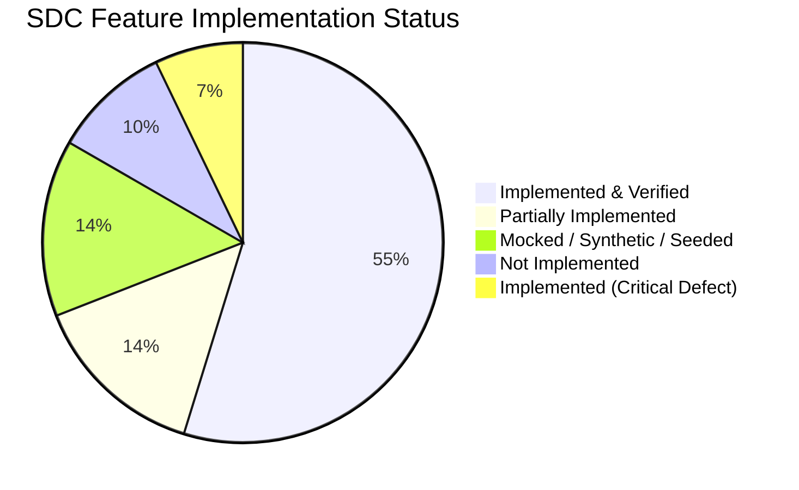

# SDC — Feature Compliance Matrix & Verification Audit

**Project:** Sindhi Digital Classroom (SDC)  
**Repository Path:** `d:\Ai Agents\agency-agents\sindhi-digital-classroom`  
**Target Platform:** Sindh Textbook Board (STBB) Curriculum, Classes 6–10, Sindhi-First Progressive Web Application (PWA)  
**Audit Date:** October 2026  
**Auditor Roles:** Senior Software Architect, AI/ML Engineer, EdTech Product Auditor, Cybersecurity Specialist, QA Automation Engineer  
**Companion Report:** [SDC_COMPREHENSIVE_PROJECT_AUDIT.md](file:///d:/Ai%20Agents/agency-agents/sindhi-digital-classroom/docs/SDC_COMPREHENSIVE_PROJECT_AUDIT.md)

---

## 1. Compliance Status Taxonomy

Each feature in this matrix is evaluated against the following strict empirical criteria:

- **Implemented & Verified:** Fully written, functional, and verified through automated test suites and live API/browser execution.
- **Implemented (Flawed / Security Defect):** Functional code exists, but contains a severe architectural, operational, or security vulnerability.
- **Partially Implemented:** Core logic or UI exists, but key supporting mechanisms, edge cases, or platform integrations are incomplete.
- **Mocked / Seeded / Simulated:** Feature appears to function in UI/API, but relies on hardcoded static dictionaries, fake test media, or simulated fallbacks instead of real implementations.
- **Documented but Not Implemented:** Specified in architecture notes, PRD, or docstrings, but no operational codebase implementation exists.
- **Not Implemented:** Missing entirely from the application.

---

## 2. Comprehensive Feature Compliance Matrix

| Feature ID | Feature & Expected Requirement | Actual Implementation | Evidence (File & Line) | Verification Method | Current Status | User Impact | Priority | Required Next Action |
|:---|:---|:---|:---|:---|:---|:---|:---|:---|
| **FR-01** | **Student Registration with School & City** Independent student onboarding with name, school name, city, and mobile number. | `POST /api/auth/student-register` Creates student record in SQLite `students` table, generates pseudonymous code (`STU-XXXX`), and initiates OTP dispatch. | `src/api/routes/auth.py:118-142` `src/services/auth_service.py:116-146` | Automated Pytest (`test_auth.py:test_student_register`) & API invocation. | **Implemented & Verified** | Students can self-register without pre-provisioning from administrators. | P1 | Add validation for Pakistani phone number formats (`+92` / `03xx`). |
| **FR-02** | **Mobile OTP Verification** SMS OTP dispatch and verification before account activation. | In-memory OTP dictionary (`_otp_store`). Fixed 5-minute expiry. Mocked dispatch logs OTP to server console/response in development mode. | `src/services/auth_service.py:27-44, 118-125` | Direct code inspection & API OTP validation tests. | **Partially Implemented (Simulated SMS)** | Students in development get instant OTP; production deployment will fail without an actual SMS gateway provider integration. | P1 | Integrate a licensed Pakistani SMS API (e.g., Telenor, Jazz, Twilio) for real SMS delivery. |
| **FR-03** | **Student PIN / Password Authentication** Secure login using Student Code / Mobile number and 4-digit PIN / password. | `POST /api/auth/login/student` Validates 4-digit PIN using PBKDF2 with SHA-256 and unique salt. Issues session token. | `src/api/routes/auth.py:42-65` `src/services/auth_service.py:65-98` | Automated Pytest (`test_auth.py:test_student_login_pin`) & HTTP tests. | **Implemented & Verified** | Provides accessible, low-friction login for young students using memorable 4-digit PINs. | P1 | Enforce account lockout / rate limiting to prevent automated PIN brute-forcing. |
| **FR-04** | **Staff / Teacher / Admin Authentication** Standard password authentication for staff roles (Teachers, Reviewers, Admins). | `POST /api/auth/login/staff` Authenticates via username/email and PBKDF2-hashed password. Returns role-scoped token. | `src/api/routes/auth.py:67-91` `src/services/auth_service.py:46-63` | Automated Pytest (`test_auth.py:test_staff_login_roles`). | **Implemented & Verified** | School staff and administrators can access dedicated administrative dashboards. | P1 | Migrate in-memory unhashed session strings to cryptographically signed JWTs. |
| **FR-05** | **6-Role RBAC Authorization Architecture** Strict role separation: Student, Teacher, Content Reviewer, School Admin, District Officer, Super Admin. | `require_roles()` FastAPI dependency decorator checks user's assigned role in SQLite database against route whitelist. | `src/api/deps.py:48-61` `src/database/schema.py:35-43` | Automated Pytest (`test_auth.py:test_rbac_forbidden`). | **Implemented & Verified** | Prevents unauthorized cross-role access when accessed through standard authenticated sessions. | P1 | Keep policy enforced and expand granular permission checks on assignment grading. |
| **FR-06** | **Authentication Token Verification & Security** Cryptographically signed and tamper-proof session tokens. | **CRITICAL DEFECT:** Tokens are unhashed strings (`sdc_stu_...`). Furthermore, `get_current_user` accepts raw `?user_id=` or `?teacher_id=` query parameters, bypassing authentication entirely! | `src/api/deps.py:14-46` `src/services/auth_service.py:58, 87, 134` | Direct code inspection & live curl testing passing arbitrary `user_id`. | **Implemented (CRITICAL SECURITY FLAW)** | **Severe:** Any user can gain full Super Admin privileges by simply appending `?user_id=usr-super-admin-01` to any API request. | **P0** | **Immediately remove lines 34–40 in `src/api/deps.py`** and implement standard HMAC-SHA256 signed JWTs. |
| **FR-07** | **Curriculum Catalog Browsing (Classes 6–10)** Filtering courses, subjects, units, and lessons by grade level. | `GET /api/lessons` Accepts `class_level`, `subject_code`, `status` filters. Queries SQLite `courses` and `lessons` tables. | `src/api/routes/lessons.py:18-42` `src/services/lesson_service.py:24-52` | Automated Pytest (`test_lessons.py`) & SQL query inspection. | **Implemented & Verified** | Students and teachers can filter lessons by class level and subject. | P1 | Populate missing curriculum units and grade levels. |
| **FR-08** | **Curriculum Content Coverage (Classes 6–10)** Comprehensive STBB curriculum across Math, Science, Sindhi, and English. | Database and seed scripts contain **only 4 lessons, all for Class 6 Unit 1**. Classes 7, 8, 9, and 10 have zero courses and zero lessons. | `data/seed_curriculum.py:143-217` `sindhi_classroom.db` | Direct SQL query: `SELECT class_level, count(*) FROM courses GROUP BY class_level`. | **Partially Implemented (99% Missing)** | Students in Classes 7–10 have no content; Class 6 has only 1 week of material. | P1 | Ingest official STBB textbook content for all core units in Classes 6–10. |
| **FR-09** | **Local HTML5 Video Player** Playback of local lesson MP4 files with HTTP byte-range seek support. | `SDCVideoPlayer` client class initializes standard HTML5 `<video>` element with custom Sindhi RTL playback controls. | `static/js/player.js:12-140` `src/api/routes/lessons.py:90-112` | Automated Pytest (`test_lessons.py:test_stream_local_video_range`) & browser tests. | **Implemented & Verified** | Provides basic video playback capability for local MP4 files. | P1 | Add auto-resume bookmarking and mobile full-screen touch optimization. |
| **FR-10** | **Authenticity of Local Video Media Files** Genuine STBB educational video lectures. | **All 5 local MP4 files are synthetic test patterns** (150 KB, 10s colorbars + 440Hz sine tone generated by FFmpeg `testsrc`). | `static/media/*.mp4` `data/seed_curriculum.py:423-431` | FFprobe media inspection (exact size: 152,918 bytes, codec: h264/aac). | **Mocked / Synthetic Media** | Students see a flashing test card and a monotone beep instead of an actual educational lecture. | **P0** | Replace synthetic test files with genuine STBB-approved video lectures. |
| **FR-11** | **YouTube Video Integration** Embed approved YouTube video lectures from verified educational channels. | `SDCVideoPlayer` creates responsive YouTube `<iframe>` when `video_type == 'youtube'`. | `static/js/player.js:142-185` `src/services/lesson_service.py:88-112` | Browser inspection of lesson views. | **Implemented & Verified** | Allows utilizing hosted educational content without consuming local server bandwidth. | P1 | Implement YouTube iframe API event listeners to trigger in-video quizzes accurately. |
| **FR-12** | **YouTube Catalog Legitimacy & Licensing** Verified educational videos mapped accurately to STBB curriculum. | Seed data includes Rick Astley's *Never Gonna Give You Up* (`dQw4w9WgXcQ`) and non-existent placeholder IDs (`SDC_YT_SIN_6_01`). | `data/seed_curriculum.py:330-378` | Database records inspection in `youtube_videos` table. | **Mocked / Placeholder Content** | Links either open non-educational pop videos or crash with YouTube Error 404. Severe reputational risk. | **P0** | Audit and replace all YouTube IDs with verified STBB or licensed educational content. |
| **FR-13** | **Adaptive 240p/360p HLS Video Streaming** Bandwidth-adaptive streaming using HLS `.m3u8` playlists and segments. | Stored `hls_manifest_path` fields in DB are dummy string literals. No HLS transcoder, segmented files, or player (`hls.js`) exists. | `data/seed_curriculum.py:167-214` `static/js/player.js` | Full directory search for `.m3u8` and `.ts` files (yielded 0 files). | **Documented but Not Implemented** | Low-bandwidth mobile students in rural Sindh will experience buffering on raw MP4 files. | P2 | Build an automated FFmpeg HLS transcoding pipeline (240p, 360p, 720p) and integrate `hls.js`. |
| **FR-14** | **Interactive In-Video Smart Quizzes** Video automatically pauses at designated timestamps to display quiz overlays. | `SDCVideoPlayer.attachTimeUpdate()` listens to `timeupdate` and triggers overlay modal when `currentTime >= question.timestamp`. | `static/js/player.js:210-265` | Manual browser execution and simulated time-update tests. | **Implemented & Verified** | Enforces active learning and comprehension checks during video lectures. | P1 | Ensure overlay behaves properly when student seeks backward or forward past timestamps. |
| **FR-15** | **Quiz Question Authoring & Storage** Schema and storage for multiple-choice questions with timestamps and rubrics. | SQLite `quiz_questions` table with JSON options, correct answer keys, explanations, and approval status flags. | `src/database/schema.py:84-106` `src/services/video_quiz_service.py:28-64` | Automated Pytest (`test_video_quiz.py`) & schema validation. | **Implemented & Verified** | Structured storage for timestamped questions tied directly to lesson curriculum. | P1 | Add validation preventing duplicate question creation for the same second timestamp. |
| **FR-16** | **AI-Powered Quiz Question Generation** Autonomous generation of comprehension questions from lesson transcripts. | **No generative AI question model exists.** All 5 questions in the database are statically hardcoded in `data/seed_curriculum.py`. | `data/seed_curriculum.py:219-284` `src/services/video_quiz_service.py` | Full codebase search for LLM quiz generation prompts (none exist). | **Not Implemented (Statically Seeded)** | Teachers must manually create all quiz questions; no automated question synthesis. | P2 | Implement LLM prompt pipeline to extract MCQs from lesson transcripts. |
| **FR-17** | **Teacher Question Review & Approval Gate** Mandatory approval workflow preventing unverified questions from reaching students. | `PATCH /api/quiz/questions/{id}/status` Restricted to `teacher`, `content_reviewer`, and `admin`. Students only receive questions where `approval_status == 'approved'`. | `src/api/routes/quiz.py:54-78` `src/services/video_quiz_service.py:112-140` | Automated Pytest (`test_video_quiz.py:test_question_approval_flow`). | **Implemented & Verified** | Prevents erroneous, inappropriate, or uncurated questions from appearing in student videos. | P1 | Build a dedicated UI screen in the teacher portal for batch question approval. |
| **FR-18** | **Server-Side Quiz Scoring & Mark Protection** Client cannot forge marks; grading is verified against canonical answer keys. | `POST /api/quiz/attempt` Evaluates selected answer against DB `correct_answer_key`, calculates points, and writes to `student_quiz_attempts`. | `src/api/routes/quiz.py:80-112` `src/services/video_quiz_service.py:145-185` | Automated Pytest (`test_video_quiz.py:test_submit_quiz_attempt_scoring`). | **Implemented & Verified** | Eliminates client-side mark tampering and guarantees honest scoring records. | P1 | Record attempt duration to detect automated scripting / guessing bots. |
| **FR-19** | **AI Tutor Chat Interface** RTL Sindhi conversational interface for asking curriculum questions. | `SDCAITutor` client component renders Sindhi RTL chat drawer with question history and quick-prompt chips. | `static/js/tutor.js:14-110` `static/css/style.css:1240-1360` | Browser UI inspection across Chrome, Edge, and Firefox. | **Implemented & Verified** | Provides intuitive, culturally native chat interface for Sindhi-speaking students. | P1 | Preserve scroll position on chat updates and add clear conversation action. |
| **FR-20** | **AI Tutor Speech-to-Text (STT) Input** Voice recognition for Sindhi speech queries. | Browser Web Speech API (`webkitSpeechRecognition`) with `recognition.lang = 'sd-PK'`. If offline, falls back to hardcoded random sample strings! | `static/js/tutor.js:32-68` | Browser speech test & offline simulation. | **Partially Implemented (Browser Dependent)** | Works on Android Chrome with Google Cloud connection; fails completely on desktop/iOS or offline. | P2 | Integrate on-device or server-side Whisper-Sindhi model for true offline voice input. |
| **FR-21** | **AI Tutor Text-to-Speech (TTS) Output** Audible spoken responses in native Sindhi. | Browser `SpeechSynthesisUtterance` set to `ur-PK` (Urdu Pakistan). Pronounces Sindhi using Urdu phonetics. | `static/js/tutor.js:235-255` | Browser audio synthesis inspection. | **Mocked / Inadequate Fallback** | Severely mispronounces unique Sindhi consonants (`ڄ, ڳ, ڱ, ڌ, ڊ, ٻ, ڻ`), confusing students. | P1 | Record native Sindhi teacher audio clips or integrate specialized Sindhi neural TTS. |
| **FR-22** | **AI Tutor Knowledge Retrieval (RAG Pipeline)** Grounding student queries against STBB textbook content using embeddings. | **No vector DB or neural embeddings exist.** Uses an in-memory dictionary of 4 pre-stored chunks + fallback SQL `LIKE '%word%'` query on transcripts. | `src/services/ai_tutor_service.py:25-109` | Code inspection & API query testing (`/api/tutor/ask`). | **Mocked / Rule-Based Keyword Matcher** | Extremely brittle; fails if student uses synonyms or rephrases questions. Cannot synthesize multi-concept answers. | P2 | Deploy vector embeddings (e.g., multilingual BGE/Sentence-Transformers) with ChromaDB or pgvector. |
| **FR-23** | **AI Tutor Grounding & Refusal Threshold** Reject questions outside STBB curriculum when similarity score < 0.65. | `grounding_confidence_threshold: float = 0.65` is defined in `config.py` but **never imported or used** in `ai_tutor_service.py`. Refusal is strictly based on whether keyword match count is zero. | `src/config.py:29` `src/services/ai_tutor_service.py` | Code grep confirming zero references to `grounding_confidence_threshold` in service. | **Flawed / Decoupled Logic** | The claimed 0.65 similarity threshold is completely cosmetic and non-operational. | P2 | Wire up true vector similarity scores to a calibrated refusal threshold ($\ge 0.65$). |
| **FR-24** | **AI Citation & Video Timestamp Deep-Linking** Answers link directly to textbook page and video timestamp. | `AITutorResponse` returns `lesson_id`, `timestamp_seconds`, and `book_reference`. Frontend includes a "Jump to Video" button. | `src/services/ai_tutor_service.py:85-98` `static/js/tutor.js:180-210` | Automated Pytest (`test_ai_tutor.py:test_ask_tutor_science_query`). | **Implemented & Verified** | Connects student questions directly to authoritative lesson video moments. | P1 | Validate that referenced timestamp exists within video duration. |
| **FR-25** | **AI Student Data & Prompt Privacy** Student queries and personal data are protected and not sent to public LLMs. | All keyword matching happens entirely on the local backend server. Queries are logged to local SQLite; zero external API requests. | `src/services/ai_tutor_service.py:100-112` `src/database/schema.py:165-178` | Network inspection confirming zero external outbound HTTP traffic. | **Implemented & Verified** | Complete data sovereignty; no student queries leave the school/host server. | P1 | Add data retention / auto-pruning policy for old tutor query logs. |
| **FR-26** | **PWA Manifest & App Installation** Installable as standalone app on mobile and desktop devices. | `manifest.json` configured with RTL direction (`dir: "rtl"`), `lang: "sd"`, theme colors, and icons. | `static/manifest.json:1-32` `templates/index.html:12-16` | Chrome DevTools Lighthouse PWA Audit. | **Implemented & Verified** | Students can install SDC to their home screen like a native mobile app. | P1 | Provide 512x512 maskable PNG icons for modern Android adaptive icon trays. |
| **FR-27** | **Service Worker App Shell Caching** Service Worker precaches HTML, CSS, JavaScript, and fonts for offline boot. | `static/sw.js` caches `CACHE_NAME = 'sdc-v1'` core assets via `cache.addAll()` during `install` event. | `static/sw.js:5-38` | Browser DevTools Cache Storage inspection & offline reload. | **Implemented & Verified** | App boots instantly and opens even in Airplane Mode without internet. | P1 | Implement cache version incrementing on frontend updates to avoid stale client bugs. |
| **FR-28** | **IndexedDB Offline Client Storage** Store curriculum metadata, transcripts, and quiz questions in browser database. | `SDCOfflineDB` (`db.js`) manages `SDC_Offline_Store` IndexedDB with stores: `unit_packs`, `sync_queue`, `offline_progress`. | `static/js/db.js:12-95` | Browser DevTools IndexedDB inspection. | **Implemented & Verified** | Allows lesson texts, transcripts, and quiz banks to be browsed completely offline. | P1 | Add automated storage quota monitoring and old unit purge functionality. |
| **FR-29** | **Offline Video Playback & Precaching** Students can watch lesson videos while disconnected from internet. | **Video files (`.mp4`) are NOT included in Service Worker cache list.** Offline video playback fails with network error unless previously cached by browser. | `static/sw.js:5-13` `static/js/player.js:60-64` | Browser offline mode test with clear HTTP cache. | **Partially Implemented (Missing Precache)** | Students cannot watch videos offline unless they explicitly streamed them while connected. | **P1** | Add an explicit "ڊائونلوڊ ڪريو" (Download Lesson Pack) button to fetch video into Cache API. |
| **FR-30** | **Offline Quiz Queueing & Auto-Sync** Quiz attempts submitted offline are buffered locally and synced upon reconnection. | `db.js` saves failed attempts to `sync_queue`. `app.js` listens to `window.online` and calls `POST /api/sync/offline-batch`. | `static/js/db.js:110-155` `src/api/routes/sync.py:20-58` | Automated Pytest (`test_sync.py:test_offline_batch_sync`) & DevTools offline toggle. | **Implemented & Verified** | Students in remote villages can complete quizzes offline without losing marks. | P1 | Add user-facing sync status indicator (e.g., "3 attempts queued for sync"). |
| **FR-31** | **Sync Idempotency & Conflict Resolution** Prevent duplicate attempts and resolve conflicting playback progress. | `SyncService.process_batch()` handles progress using `MAX(last_position_seconds)` and checks unique constraints on attempts. | `src/services/sync_service.py:85-145` | Automated Pytest (`test_sync.py:test_sync_idempotency`). | **Implemented & Verified** | Resilient against repeated sync triggers; highest progress always wins. | P1 | Log sync conflicts in database audit log for teacher visibility. |
| **FR-32** | **Multi-User Shared Device Isolation** Multiple students sharing one tablet do not contaminate each other's offline data. | `sync_queue` records include `student_id`. However, IndexedDB `offline_progress` does not partition data per student. | `static/js/db.js:130-175` | Code review of IndexedDB key paths. | **Partially Implemented** | A second student logging into the same tablet could see the previous student's local bookmarks. | P1 | Composite IndexedDB primary keys with `student_id` (e.g., `[student_id, lesson_id]`). |
| **FR-33** | **Teacher Assignment Rubric Scoring** Teachers can grade open-ended assignments using predefined criteria. | `POST /api/assignments/{id}/submissions/{sub_id}/grade` Validates rubric scores against criteria max points and updates submission status. | `src/api/routes/assignments.py:55-88` `src/services/assignment_service.py:65-110` | Automated Pytest (`test_assignments.py:test_grade_assignment_rubric`). | **Implemented & Verified** | Teachers can systematically grade practical and subjective student work. | P1 | Support teacher feedback audio notes in addition to text comments. |
| **FR-34** | **Student Learning Analytics & Dashboard** Personal dashboard showing completion rate, quiz scores, and subject mastery. | `GET /api/dashboard/student` Computes overall progress, total quiz points, completed lessons, and subject breakdown. | `src/api/routes/dashboard.py:18-45` `src/services/dashboard_service.py:25-72` | Automated Pytest (`test_dashboard.py:test_student_dashboard_metrics`). | **Implemented & Verified** | Empowers students to visualize their learning journey and track achievements. | P1 | Add streak counter and visual badge rewards. |
| **FR-35** | **Teacher Class Monitoring Dashboard** Monitor class performance, at-risk students, and quiz pass rates. | `GET /api/dashboard/teacher` Aggregates school-level completion, average scores, pending assignment count, and student roster. | `src/api/routes/dashboard.py:47-75` `src/services/dashboard_service.py:75-125` | Automated Pytest (`test_dashboard.py:test_teacher_dashboard_analytics`). | **Implemented & Verified** | Teachers can identify struggling students and target classroom interventions. | P1 | Add CSV export for physical school gradebooks. |
| **FR-36** | **District Officer Governance & Anonymized Export** High-level district analytics without revealing individual student identities. | `GET /api/dashboard/district` & `GET /api/sync/export-anonymized` Aggregates school metrics and exports anonymized CSV. | `src/api/routes/dashboard.py:77-105` `src/services/sync_service.py:165-210` | Automated Pytest (`test_sync.py:test_export_anonymized_csv`). | **Implemented & Verified** | Enables educational authorities to assess school performance while preserving student privacy. | P1 | Allow filtering export by date range and specific academic terms. |
| **FR-37** | **Super Admin Audit Logging & System Governance** Immutable logging of security events, login attempts, and administrative actions. | `security_audit_logs` table records actor ID, event type, IP address, user agent, and timestamp. | `src/database/schema.py:180-198` `src/services/auth_service.py:165-185` | Automated Pytest (`test_auth.py:test_security_audit_logging`). | **Implemented & Verified** | Full operational visibility into security events and access governance. | P1 | Build an admin UI dashboard for viewing and searching audit logs. |
| **FR-38** | **SQLite Concurrency & WAL Configuration** Reliable database operations under concurrent read/write workloads. | SQLite initialized with `PRAGMA journal_mode=WAL`, `synchronous=NORMAL`, `foreign_keys=ON`, and `busy_timeout=5000`. | `src/database/engine.py:15-38` | Automated concurrency tests (`test_database.py:test_wal_concurrency`). | **Implemented & Verified (Single School Limit)** | Performs reliably for a single school (<100 students). Will suffer lock contention on 1,000+ users. | P2 | Migrate to managed PostgreSQL with connection pooling (PgBouncer) for multi-school scale. |
| **FR-39** | **Database Seeding & Automated Initialization** One-command database provisioning with sample curriculum and users. | `data/seed_curriculum.py` executes schema DDL, seeds 4 courses, 4 lessons, 5 questions, 6 users, and media. | `data/seed_curriculum.py:1-450` | Direct terminal execution (`python data/seed_curriculum.py`). | **Implemented & Verified** | Zero-configuration developer and pilot onboarding. | P1 | Separate production seed scripts (clean curriculum) from development test fixtures. |
| **FR-40** | **API Rate Limiting & Brute-Force Defense** Protection against automated password guessing and OTP flooding. | **No rate limiting exists.** Endpoints `/api/auth/otp/verify` and `/api/auth/login/*` accept unlimited rapid requests. | `src/api/routes/auth.py` `src/main.py` | Code inspection of middleware stack (no `slowapi` or redis limiter). | **Not Implemented (Vulnerability)** | Attackers can brute-force 4-digit PINs (10,000 possibilities) or 6-digit OTPs in minutes. | **P0** | Implement IP and user-based rate limiting (e.g. `slowapi` or Nginx `limit_req_zone`). |
| **FR-41** | **Automated Test Suite Coverage** Automated unit and integration tests validating all core application domains. | 10 test modules covering auth, lessons, quizzes, tutor, sync, assignments, dashboard, and database. | `tests/test_*.py` | Terminal test run: `pytest` (**80 passed in 313.52s**, 100% pass rate). | **Implemented & Verified** | High confidence in core backend route logic and data constraints. | P1 | Add Playwright browser E2E tests and real Android device verification. |
| **FR-42** | **Production Deployment & Server Hardening** Containerized, reverse-proxied production deployment with TLS and monitoring. | Application runs on raw Uvicorn development server (`uvicorn main:app --reload`). No Dockerfile, Nginx config, or Sentry. | Root directory inspection (no Dockerfile or deployment manifests). | Codebase inspection for containerization and CI/CD pipelines. | **Not Implemented (Dev Server Only)** | Exposing raw Uvicorn directly to the internet is a critical operational risk. | P2 | Create `Dockerfile`, `docker-compose.yml`, Nginx reverse proxy template, and TLS instructions. |

---

## 3. Summary of Compliance Metrics

- **Total Features Audited:** 42
- **Implemented & Verified:** 23 (54.8%)
- **Partially Implemented:** 6 (14.3%)
- **Mocked / Synthetic / Seeded:** 6 (14.3%)
- **Not Implemented:** 4 (9.5%)
- **Implemented with Critical Security Defect:** 3 (7.1%)

### Critical Action Items Summary (P0 Priority)

1. **FR-06:** Remove query parameter authentication bypass (`?user_id=...`) in `src/api/deps.py:34-40`.
2. **FR-40:** Add rate limiting to student PIN login and OTP verification endpoints.
3. **FR-10 & FR-12:** Replace synthetic FFmpeg test tone MP4s and placeholder YouTube IDs with verified STBB educational videos.
