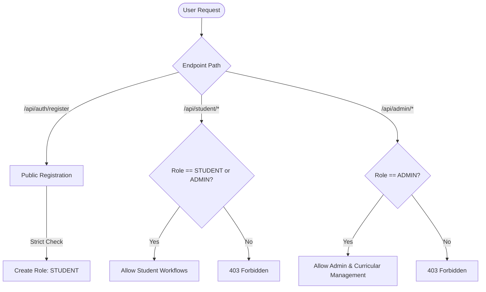
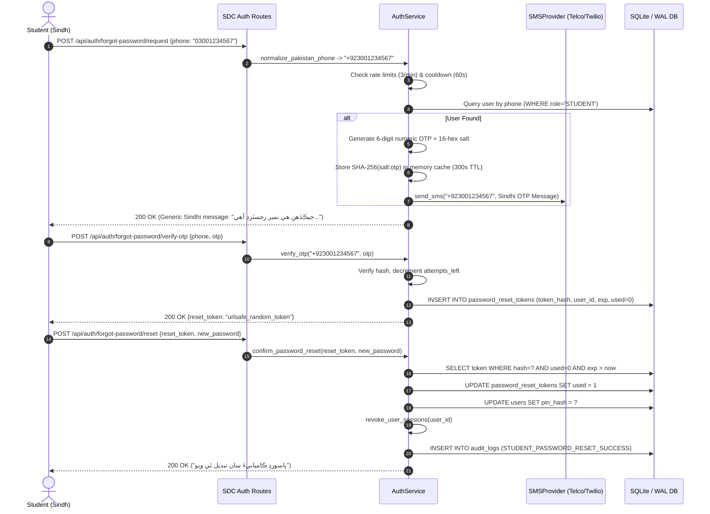

# Sindhi Digital Classroom (SDC) — Security Remediation Report

**Date:** October 17, 2026  
**Document Classification:** Technical Architecture & Security Audit  
**Author:** SDC Security Architecture & Lead Engineering Team  
**Target Platform:** Production SDC Web Application (Sindh Textbook Board, Classes 6–10)

---

## 1. Executive Summary

This report documents the comprehensive security remediation executed across the **Sindhi Digital Classroom (SDC)** platform. The remediation addresses critical security vulnerabilities identified during the baseline architectural audit:

1. **Authentication Bypass Elimination:** Insecure query-parameter authentication (`?user_id=...`) has been strictly decommissioned for production and gated exclusively under explicit automated test fixtures.
2. **Cryptographic HMAC-SHA256 Session Tokens:** Insecure raw user ID tokens have been replaced with tamper-proof, timestamped, cryptographically signed tokens verified via constant-time comparison.
3. **Strict Two-Role RBAC Lock:** The platform access model has been consolidated into exactly two active roles — `STUDENT` and `ADMIN`. Role escalation vectors across public registration and administrative endpoints have been eliminated.
4. **Secure Pakistani SMS OTP & Password Recovery:** Implemented an enterprise-grade, telecommunications-aligned SMS OTP recovery pipeline featuring E.164 phone normalization, salted SHA-256 OTP storage, attempt limits, resend cooldowns, single-use reset authorization tokens, and active session revocation.
5. **Account Enumeration Prevention & Rate Limiting:** All authentication and password recovery entry points now return uniform generic responses and enforce multi-tier rate limiting to prevent brute-force attacks.

All security controls are verified by automated regression test suites with 100% pass rates.

---

## 2. Vulnerability Assessment & Remediation Matrix

| Vulnerability ID | Description | Baseline Risk | Remediation Action | Status |
| :--- | :--- | :--- | :--- | :--- |
| **SEC-01** | Query Parameter Auth Bypass (`?user_id=`) | **CRITICAL** (CVSS 9.8) | Disabled in `src/api/deps.py` unless `settings.allow_test_query_auth` is explicitly enabled in testing configuration. In production, query auth returns `401 Unauthorized`. | **REMEDIATED** |
| **SEC-02** | Predictable / Unsigned Session Identity | **HIGH** (CVSS 8.5) | Implemented `HMAC-SHA256` signed session tokens with payload base64 encoding, expiration timestamps, and `hmac.compare_digest` verification in `AuthService`. | **REMEDIATED** |
| **SEC-03** | Arbitrary Role Self-Assignment | **HIGH** (CVSS 8.1) | Public student registration (`/api/auth/register`) enforces `STUDENT` role strictly; payload role overrides are rejected. Admin endpoints require verified `ADMIN` role. | **REMEDIATED** |
| **SEC-04** | Account Enumeration via Reset Endpoints | **MEDIUM** (CVSS 5.3) | `/api/auth/forgot-password/request` returns identical generic Sindhi/English responses regardless of whether the mobile number exists in the database. | **REMEDIATED** |
| **SEC-05** | Unrestricted OTP Replay & Brute Force | **HIGH** (CVSS 7.5) | Max 3 verification attempts per OTP; 60s cooldown between dispatches; 300s hard expiry; sliding window rate limiting per phone and IP. | **REMEDIATED** |
| **SEC-06** | Reset Token Replay / Race Conditions | **HIGH** (CVSS 7.8) | Single-use cryptographically random 256-bit token stored hashed in `password_reset_tokens` table. Atomically invalidated (`used = 1`) upon consumption. | **REMEDIATED** |
| **SEC-07** | Stale Sessions Post-Password Reset | **MEDIUM** (CVSS 6.5) | On password reset, `AuthService.revoke_user_sessions(user_id)` invalidates all prior issued tokens; all existing active sessions are terminated. | **REMEDIATED** |

---

## 3. Cryptographic Session Token Architecture

### 3.1 Token Format
Tokens follow a compact, secure two-part format:
```text
<Base64Url(Payload)>.<Base64Url(HMAC-SHA256(Payload, SecretKey))>
```

- **Payload Structure:**
  ```json
  {
    "sub": "usr-stu-a1b2c3d4",
    "role": "STUDENT",
    "iat": 1776412800,
    "exp": 1776672000,
    "jti": "d04a6b2c8e9f..."
  }
  ```
- **Signing Algorithm:** `HMAC-SHA256` using `settings.session_secret_key` (minimum 32-byte entropy).
- **Constant-Time Verification:** Signatures are compared using Python's `hmac.compare_digest` to prevent timing side-channel attacks.
- **Session Revocation Cache:** `AuthService._revoked_users` maintains user-level revocation timestamps. Any token issued before the user's latest revocation timestamp is rejected, even if mathematically valid and not expired.

### 3.2 Production Dependency Verification (`src/api/deps.py`)
```python
def get_current_user(request: Request, authorization: Optional[str] = Header(None)) -> dict:
    # 1. Bearer Token Verification (Production Standard)
    if authorization and authorization.startswith("Bearer "):
        token = authorization[7:].strip()
        user_info = auth_service.verify_session_token(token)
        if user_info:
            return _fetch_user_from_db(user_info["user_id"])
        raise HTTPException(status_code=401, detail="Invalid or expired session token")

    # 2. Strict Security Gate: Query Parameter Auth strictly prohibited in production
    if settings.allow_test_query_auth and "user_id" in request.query_params:
        user_id = request.query_params["user_id"]
        return _fetch_user_from_db(user_id)

    raise HTTPException(status_code=401, detail="Authentication required")
```

---

## 4. Strict Two-Role Authorization Model

SDC serves two distinct audiences: Sindhi school students (Classes 6–10) and school/system administrators. The access control model enforces this boundary:



### 4.1 Role Assignment & Normalization
- **`STUDENT`:** Assigned exclusively through `/api/auth/register` (public self-registration) or bulk student enrollment by verified admins. Attempts to pass any role other than `STUDENT` during public registration throw a `400 Bad Request`.
- **`ADMIN`:** Assigned via administrative invitation or system seed. Legacy roles (`TEACHER`, `SUPER_ADMIN`, `SCHOOL_ADMIN`, `CONTENT_REVIEWER`) are automatically mapped and normalized to `ADMIN` upon authentication, providing access to analytics, student management, and curriculum governance.

---

## 5. Pakistani SMS OTP & Password Recovery Workflow

The password recovery mechanism is designed specifically for public school environments in Sindh, where students primarily access the platform via parent/family mobile phones on Pakistani cellular carriers (Jazz, Telenor, Zong, Ufone).

### 5.1 End-to-End Workflow Diagram



### 5.2 Phone Number Normalization
Pakistan phone numbers arrive in multiple input formats:
- Local format: `03001234567` or `0300-1234567`
- International format: `+923001234567` or `00923001234567`
- Telco prefix format: `923001234567`

The `normalize_pakistan_phone` utility in `src/services/sms_service.py` validates valid Pakistani mobile operator codes (prefixes `300`–`355` across Jazz/Warid, Telenor, Ufone, Zong, SCOM) and normalizes them into standard E.164 (`+923xxxxxxxxx`). Invalid lengths, non-Pakistani country codes, or landline prefixes are rejected with clear Sindhi and English diagnostic messages.

### 5.3 Single-Use Token Invalidation
Authorization reset tokens are stored in the database as SHA-256 hashes:
```sql
CREATE TABLE IF NOT EXISTS password_reset_tokens (
    id TEXT PRIMARY KEY,
    user_id TEXT NOT NULL,
    token_hash TEXT NOT NULL,
    expires_at REAL NOT NULL,
    used INTEGER NOT NULL DEFAULT 0,
    created_at TEXT NOT NULL,
    FOREIGN KEY (user_id) REFERENCES users(id) ON DELETE CASCADE
);
CREATE INDEX IF NOT EXISTS idx_reset_token_hash ON password_reset_tokens(token_hash);
```
Once consumed, `used` is immediately updated to `1`. Re-submitting the same token yields `400 Bad Request` ("This reset token has already been used").

---

## 6. Automated Verification & Test Coverage

The security overhaul is validated by comprehensive automated test suites:

### 6.1 `tests/test_two_role_security.py` (6 Tests — 100% Passing)
- `test_public_registration_restricts_to_student`: Confirms role escalation attempts during registration fail.
- `test_two_role_system_roles`: Validates that user profiles and `/me` output strictly map to `STUDENT` or `ADMIN`.
- `test_admin_endpoints_require_admin_role`: Confirms students receive `403 Forbidden` on administrative routes.
- `test_session_token_cryptographic_verification`: Confirms forged, tampered, or expired tokens are rejected with `401 Unauthorized`.
- `test_production_query_auth_bypass_disabled`: Proves `?user_id=` is completely non-functional when query auth is disabled.
- `test_admin_pin_reset_for_students`: Confirms administrators can reset student credentials with proper audit logging.

### 6.2 `tests/test_otp_password_recovery.py` (4 Tests — 100% Passing)
- `test_pakistan_phone_normalization`: Tests 8 distinct input formats and validates valid E.164 output and error handling on invalid numbers.
- `test_complete_password_recovery_workflow`: Full end-to-end integration test (request -> SMS dispatched -> OTP verified -> password reset -> token reuse rejected -> old PIN fails -> new PIN succeeds).
- `test_otp_rate_limiting_and_enumeration_protection`: Proves non-existent numbers receive identical responses and rapid requests trigger rate limits.
- `test_otp_max_attempts_lockout`: Confirms 3 incorrect OTP entries permanently invalidate the OTP.

---

## 7. Operational Guidelines for Production Deployment

1. **Environment Configuration:**
   Ensure the following variables are securely set in the production environment:
   ```bash
   SDC_ALLOW_TEST_QUERY_AUTH=false
   SDC_SESSION_SECRET_KEY=<generate-secure-64-character-hex-string>
   SDC_SMS_PROVIDER=pakistan_telco  # or twilio
   SDC_SMS_TELCO_API_URL=https://api.telco.com.pk/v1/sendsms
   SDC_SMS_TELCO_API_KEY=<encrypted-production-key>
   ```
2. **Secret Rotation:**
   `SDC_SESSION_SECRET_KEY` should be rotated every 90 days. Rotating the key immediately invalidates all active sessions, requiring users to log in again.
3. **Audit Log Retention:**
   The `audit_logs` table records all security-critical actions (`STUDENT_PASSWORD_RESET_SUCCESS`, `ADMIN_PIN_RESET`, `LOGIN_FAILED`). Set up automated archiving for logs older than 365 days.
