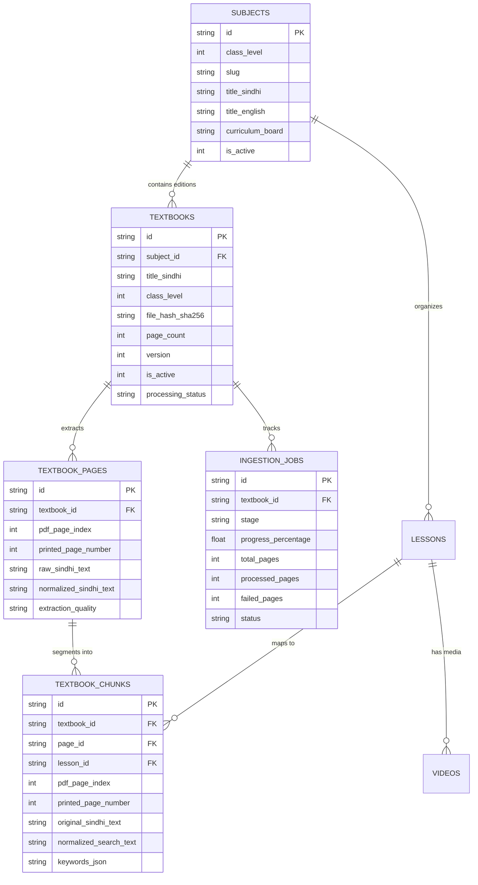

# SDC Multi-Subject & Textbook Ingestion Architecture
**Project:** Sindhi Digital Classroom (SDC)  
**Milestone:** Phase 3.2 — Reusable Multi-Subject Curriculum & Textbook Pipeline  
**Date:** 2026-10-18  
**Author:** Agency Antigravity Backend Architect & Database Optimizer  

---

## 1. Overview & Architectural Goals

The Sindhi Digital Classroom previously relied on synthetic hardcoded curriculum snippets in Python services. To support **any subject and grade** (Grade 6 Science initially, followed by Grade 6 Math, Grade 6 Sindhi, Grade 7 Science, and other grades) without developers editing code or hardcoding topic names, SDC introduces a **data-driven, schema-enforced curriculum and textbook ingestion architecture**.

### Core Guarantees:
1. **Multi-Subject Extensibility:** Adding a subject (e.g. Science, Mathematics, Social Studies) is a configuration and database operation via Admin API, not a code deployment.
2. **Strict Curriculum Scoping:** Chunks are strictly bound to `class_level`, `subject_id`, `textbook_id`, and `lesson_id`. Retrieval queries NEVER leak context across different subjects or grades.
3. **Traceability to Printed Page:** Every chunk preserves both the physical `pdf_page_index` (0-indexed) and the printed `printed_page_number` from the textbook margin, providing verifiable citations for students.
4. **Preservation of Sindhi Script:** Raw extracted text (including diacritics and Arabic presentation forms) is stored intact for exact citations, while an NFKC diacritic-stripped normalized representation is indexed for high-recall lexical search.
5. **Admin Review & Activation Gate:** Newly uploaded textbooks remain `is_active: 0` until an Admin reviews the extraction coverage, error report, and activates the edition.

---

## 2. Relational Entity-Relationship (ER) Architecture



---

## 3. Ingestion Pipeline Stages

```
   [ Admin PDF Upload ]
           │
           ▼
1. Validation & Security Gate
   - File size <= 100MB limit
   - Magic bytes verify `%PDF-` signature
   - SHA-256 hash computed for duplicate upload detection
           │
           ▼
2. Page-by-Page Extraction (`pypdf` + NFKC Normalizer)
   - Extract raw text per physical page
   - Map Arabic Presentation Forms-A/B (U+FB50-U+FEFF) to standard 52 Sindhi characters
   - Detect image-only pages (<20 chars) -> tag as `SCANNED_IMAGE`
           │
           ▼
3. Chunking & Search Token Generation
   - Bounded paragraph and concept chunks (150 - 300 words)
   - Preserve exact line breaks & punctuation in `original_sindhi_text`
   - Generate diacritic-stripped query tokens in `normalized_search_text`
           │
           ▼
4. Ingestion Diagnostics & Admin Verification Gate
   - Total pages vs extracted pages
   - Suspiciously low text coverage flagged
   - Status set to `COMPLETED` (or `OCR_REQUIRED` if scanned)
   - Admin inspects report -> Triggers `POST /api/admin/textbooks/{id}/activate`
```

---

## 4. Security & Isolation Controls

1. **Path Traversal Defense:** Uploaded PDFs are stored in sandboxed directory `data/textbooks/{class_level}/{subject_slug}/{sha256}.pdf` with strictly sanitized random UUID filenames.
2. **Access Control:** All upload, reprocess, and activate endpoints are locked with `require_roles(UserRole.ADMIN)`.
3. **Zero Data Leakage:** Student tutor endpoints only query `textbooks` where `is_active = 1` matching the student's requested class level and subject ID.
